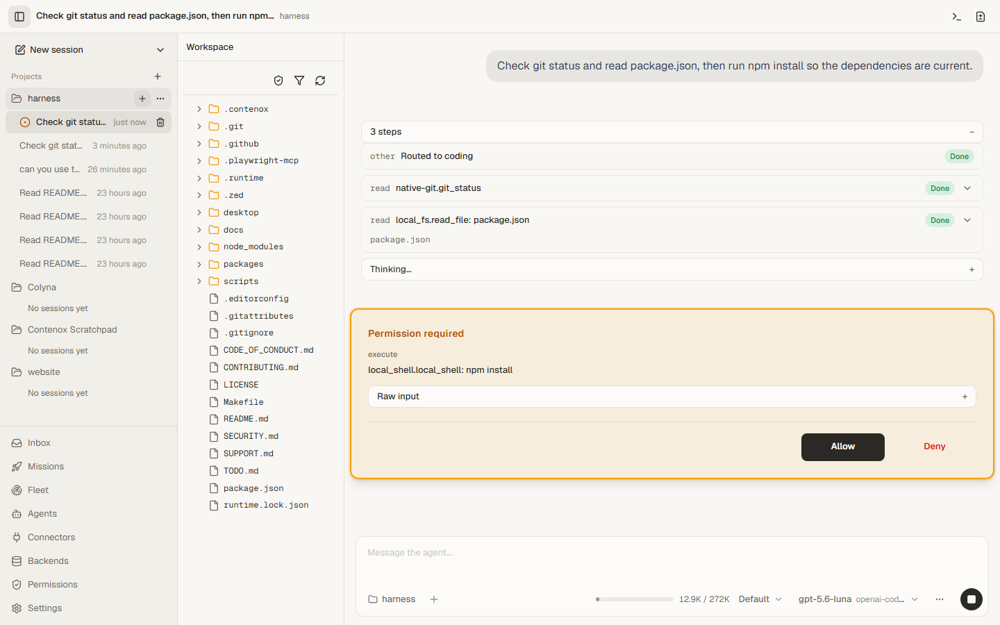

# Contenox

**YOLO speed on your code — without the YOLO horror story.**

Contenox is a free, open-source desktop app. Point an agent at one of your projects and let it read, write and run your code at full speed. Bring your own AI — a subscription you already pay for, a cloud key, or a model running on your own machine.

Your edits, your build and your tests just run, no prompts. The agent only stops for the handful of moves that could actually burn you, and it can never reach your keys or your machine. Nothing to switch off, nothing to regret.

Docs, downloads and guides: **[contenox.com](https://contenox.com)**. Made by Alexander Ertli.

---

## Why you won't switch it off

Most AI coding tools ask before every edit and every command, so the first thing people do is turn the asking off — and then one bad run leaks a key or wipes a folder. Contenox asks only when it matters. There's nothing worth switching off, and the moves that could hurt you stay blocked even when you're racing.



The shipped **Default** set:

* **Reads and edits the project without asking.** The agent is confined to the open project folder. `.env` files and keys ask before they are read.
* **Runs the project's own loop without asking.** `go test`, `npm run build`, `cargo check`, `pytest`, `make test`, git reads, and plain readers such as `grep`, `ls` or `Get-Content`, including pipelines of them (`git log --oneline | head -n 20`).
* **Asks before anything that reaches further.** Installs, deletes, moves, `git commit`, `git push`, anything with a redirect or a `$(...)`, and every command the list above doesn't name.
* **Refuses what no agent needs.** SSH and GPG keys, cloud credentials, OS keychains, password managers, wallet files, browser profiles and shell history cannot be read or written. Shell startup files, login items, git hooks and the permission policy itself cannot be written, so an agent can't widen its own permissions.

Other sets ship beside it: **Ask always**, **Read only**, **Strict** (refuse what isn't named), and **Dev** (your own machine, still asking before risky commands). Switch per chat from the chip above the composer, edit any set on the **Permissions** page, or open `agents.toml` and edit it as text. There is no "always allow" and no bypass mode.

---

## What you get

* **Chat in a project.** Sessions are grouped by project in the sidebar; each keeps its own model, permission set and connectors.
* **Approval cards, not pop-ups.** When something needs you, a card shows the exact path or command, with **Allow** and **Deny**. The agent waits.
* **Any provider.** Ollama (local or cloud), OpenAI, a ChatGPT subscription, Anthropic, Google Gemini and Vertex AI, DeepSeek, Alibaba Cloud Model Studio, Mistral, OpenRouter, AWS Bedrock and any vLLM or OpenAI-compatible endpoint. API keys live in your local database; the model named in a chat is the model that answers.
* **Connectors.** Add MCP servers (local or remote) and OpenAPI services, switch single tools on or off, and choose which chats see them.
* **Other agents, same rules.** Claude Code can run inside Contenox; its edits go through the same approval cards.
* **Your editor, same runtime.** The bundled `contenox-runtime` speaks the [Agent Client Protocol](https://agentclientprotocol.com) over stdio for Zed, JetBrains and AionUi.
* **Everything local.** Sessions, settings, approvals and provider connections are SQLite files in your user profile. Nothing is proxied through a Contenox server.

---

## Install

Download the installer for your system from **[contenox.com](https://contenox.com)**: Windows (`.exe`), macOS (`.dmg`), Linux (`.deb`, `.rpm`). Every release ships a `SHA256SUMS` file and a detached GPG signature.

The app bundles the runtime. To use the command line as well, choose **File → Install ‘contenox-runtime’ Command in PATH** in the app, or install the runtime on its own from [contenox/runtime](https://github.com/contenox/runtime). The [install guide](https://contenox.com/docs/cli/install/) covers both.

---

## The command line

The same runtime, the same database, no app window:

```bash
contenox-runtime setup                              # pick a provider, a model and an API key
contenox-runtime "explain the build in this folder" # chat in the current project
contenox-runtime session list                       # past chats, per project
contenox-runtime serve                              # HTTP API and ACP WebSocket for local clients
contenox-runtime acp                                # ACP over stdio, for editors
```

Backends are configuration, not code:

```bash
contenox-runtime backend add ollama   --type ollama
contenox-runtime backend add openai   --type openai   --api-key-env OPENAI_API_KEY
contenox-runtime backend add deepseek --type deepseek --api-key-env DEEPSEEK_API_KEY
contenox-runtime backend add alibaba  --type alibaba-cloud --api-key-env DASHSCOPE_API_KEY
contenox-runtime backend add chatgpt  --type openai-codex && contenox-runtime backend login chatgpt

contenox-runtime config set default-provider ollama
contenox-runtime config set default-model    qwen3:8b
```

Connect tools:

```bash
contenox-runtime mcp add fs --transport stdio --command npx --args "-y,@modelcontextprotocol/server-filesystem,/tmp"
contenox-runtime mcp add remote --transport http --url https://mcp.example.com/mcp
contenox-runtime tools add weather --url https://api.weather.gov
```

Full reference: [contenox.com/docs/cli/reference](https://contenox.com/docs/cli/reference/).

### Zed

Add to `~/.config/zed/settings.json`:

```json
{
  "agent_servers": {
    "Contenox": {
      "type": "custom",
      "command": "contenox-runtime",
      "args": ["acp"]
    }
  }
}
```

Approval cards show up as the editor's own permission prompts. Guides: [Zed](https://contenox.com/docs/integrations/editors/zed/), [JetBrains](https://contenox.com/docs/integrations/editors/jetbrains/), [AionUi](https://contenox.com/docs/integrations/editors/aionui/).

---

## Building from source

This repository is the desktop app and its UI (Electron, React). The runtime is Go and lives in [contenox/runtime](https://github.com/contenox/runtime); this repository pins a released runtime version in `runtime.lock.json` and downloads it.

You need **Node.js 22+** and npm.

```bash
git clone https://github.com/contenox/harness
cd harness
npm run ci               # install, build, typecheck, lint, test
npm run runtime-fetch    # download and verify the pinned runtime
npm run package-dir      # unpacked desktop app for this machine
npm run package          # installers for this machine
```

The scripts at the repository root only run `scripts/tasks.mjs`; nothing is installed at the root. `npm run help` lists every task. Options go after `--`, for example `npm run qa -- --runtime-bin=<path>`. `make <task>` is an alias for the same tasks.

To run the UI against a runtime you built yourself, see [CONTRIBUTING.md](CONTRIBUTING.md).

---

## Roadmap

Planned, in the order we expect to use them:

* **Stay in flow:** find any file or text in your project and move through it without leaving the keyboard.
* **Agents that react:** a file changes, a commit lands, and the right agent picks up the work without being asked.
* **Review on your terms:** see what an agent changed, side by side, and accept it piece by piece.
* **Your machines, not just this one:** run agents on your own servers and VMs and work with them from here.
* **Later:** agents that know your whole codebase, completion as you type, and your existing agent definitions working here unchanged.

Small releases, no dates.

---

## License

Apache-2.0. See [LICENSE](LICENSE), [CONTRIBUTING.md](CONTRIBUTING.md) and [SECURITY.md](SECURITY.md).
